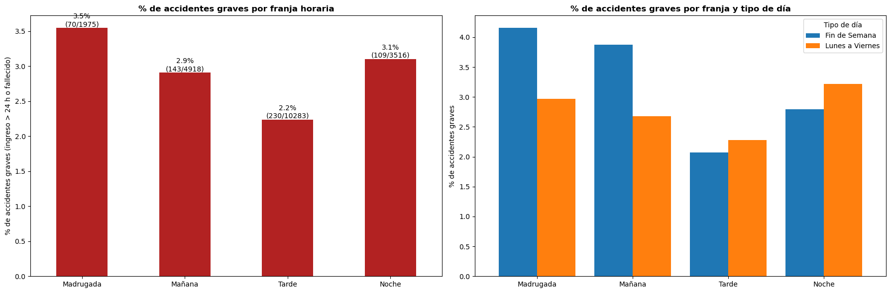
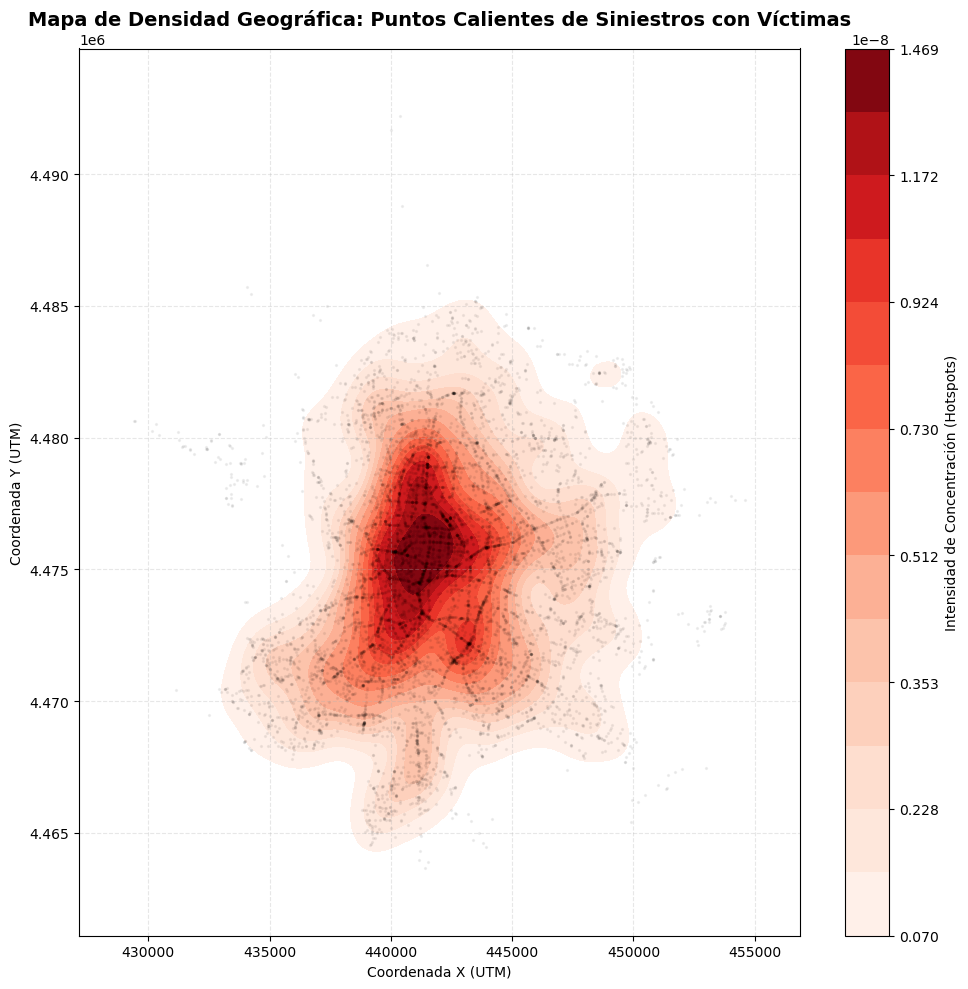

# 03 · Accidentes de tráfico en Madrid (2024)

EDA y modelo de regresión logística sobre los partes de accidentes de Madrid (`parteAccidentes.xlsx`, 49.340 filas).

## Fuente de los datos

Partes de accidentes de tráfico de la ciudad de Madrid (año 2024), publicados por la Dirección General de la
Policía Municipal en el Portal de datos abiertos del Ayuntamiento de Madrid:
[Accidentes de tráfico de la ciudad de Madrid](https://datos.madrid.es/dataset/300228-0-accidentes-trafico-detalle).
Licencia [CC BY 4.0](https://creativecommons.org/licenses/by/4.0/legalcode.es) (se exige atribución a la fuente).
Cada fila es una **persona implicada**, no un accidente.

## Contenido

| Archivo | Descripción |
| :--- | :--- |
| `proyectoMadrid.ipynb` | Parte 1: EDA (descripción, limpieza, univariante, bivariante, mapa de calor y mapa de densidad geográfico). Parte 2: modelo que predice el positivo en alcohol |
| `models.py` | Clase `AlcoholLogisticModel` (fit, predict, evaluate con accuracy/precision/recall/F1/matriz de confusión, save/load) |
| `test_models.py` | Test de la clase, incluido el ciclo guardar/cargar con comprobación de predicciones idénticas |
| `parteAccidentes.xlsx` | Datos |

## Puntos metodológicos

- **Granularidad:** una fila es una *persona implicada*, no un accidente. Los conteos de siniestros se hacen agrupando por `num_expediente` (20.698 accidentes); el modelo se mantiene a nivel persona.
- **Sin fuga de datos:** las predictoras se codifican con one-hot, sin usar nunca la variable objetivo.
- **Desbalanceo:** solo el 2,9 % de las personas da positivo en alcohol. El modelo usa `class_weight='balanced'` y se evalúa con recall y precisión, no solo con la exactitud (test: accuracy 0,80, recall 0,72, precisión 0,10).
- **Pregunta de negocio:** la franja con mayor proporción de accidentes graves (ingreso > 24 h o fallecido) es la madrugada (3,5 %); la tarde acumula más casos pero es la menos grave en proporción (2,2 %).

## Resultados

Proporción de accidentes graves por franja horaria (izquierda: todos los días; derecha: según tipo de día):



Mapa de densidad (KDE) de accidentes con víctimas, un punto por accidente:



## Ejecución

```bash
pip install -r requirements.txt
jupyter notebook proyectoMadrid.ipynb
python -c "from test_models import ejecutar_test; ejecutar_test()"
```
