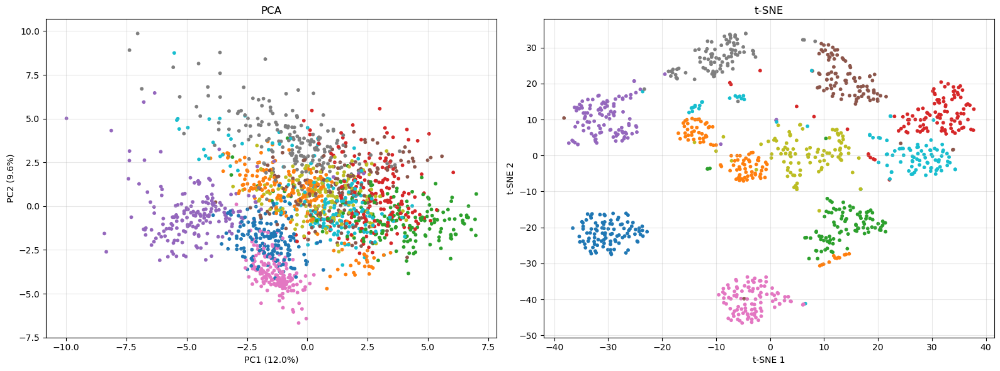
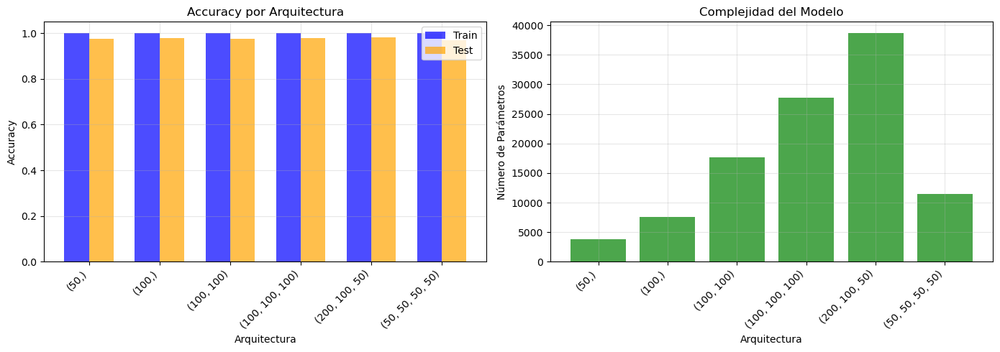
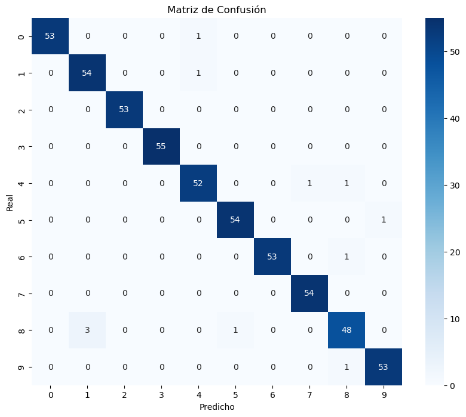

# 04 · Clasificación de dígitos manuscritos con MLP

Proyecto de Machine Learning de extremo a extremo con 1797 imágenes de 8×8 píxeles (10 clases). Recorre todo el flujo, desde la representación vectorial de las imágenes hasta la comparación final de modelos.

## Fuente de los datos

Dataset *Optical Recognition of Handwritten Digits* (E. Alpaydin y C. Kaynak, UCI Machine Learning Repository, licencia [CC BY 4.0](https://creativecommons.org/licenses/by/4.0/)), cargado con `sklearn.datasets.load_digits`. No hace falta descargar nada: viene incluido en scikit-learn.

## Contenido

| Archivo | Descripción |
| :--- | :--- |
| `Sistema_Clasificacion_Imagenes.ipynb` | Notebook completo con el análisis, las respuestas razonadas y las salidas guardadas |
| `requirements.txt` | Dependencias |

Secciones del notebook:

1. **Espacios vectoriales:** imágenes como vectores de 64 dimensiones.
2. **Distancias y similitud:** euclídea, Manhattan, Hamming y coseno; matriz de distancias.
3. **Preprocesamiento:** `StandardScaler` frente a `MinMaxScaler` y su comportamiento ante outliers.
4. **Transformación de variables:** one-hot con `np.eye` y `OneHotEncoder`.
5. **Reducción de dimensionalidad:** PCA (varianza explicada) y t-SNE.
6. **Modelos:** `MLPClassifier`, comparación de arquitecturas y matriz de confusión.
7. **Pipeline completo:** `StandardScaler` + PCA + MLP con validación cruzada y `GridSearchCV`.
8. **Comparativa final:** regresión logística, KNN, Random Forest, SVM y MLP.

## Puntos metodológicos

- **Sin fuga de datos:** los escaladores se ajustan solo con train y, en el pipeline, el test se aparta **antes** de la validación cruzada y del grid search.
- **Estimación limpia:** el 97,8 % final se mide sobre un test que no interviene en ninguna decisión de hiperparámetros.
- **Diferencias dentro del ruido:** entre modelos hay pocas imágenes de diferencia sobre 540 de test; con un único split no hay un ganador claro.
- **Rango válido del PCA:** `n_components` no puede superar las 64 características del dataset.

## Resultados

| Modelo | Accuracy en test |
| :--- | :--- |
| SVM (RBF) | 0,9833 |
| Regresión logística | 0,9815 |
| MLP (1 o 3 capas) | 0,9796 |
| KNN (k=5) | 0,9704 |
| Random Forest | 0,9685 |

- Pipeline `StandardScaler` + PCA (50 componentes, 98,6 % de varianza) + MLP: **97,2 %** en validación cruzada y **97,8 %** en el test reservado.
- Una red mayor no mejora de forma apreciable a una pequeña, ((50,) o (100,)).
- `MinMaxScaler` es mucho más sensible a los outliers que `StandardScaler`.
- El dígito más difícil de clasificar es el 8.

Comparación PCA frente a t-SNE (izquierda: PCA, derecha: t-SNE):



Accuracy y número de parámetros por arquitectura:



Matriz de confusión del MLP de una capa de 100 neuronas:



## Ejecución

```bash
pip install -r requirements.txt
jupyter notebook Sistema_Clasificacion_Imagenes.ipynb
```
